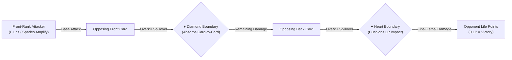
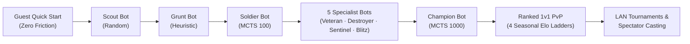
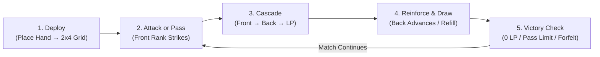
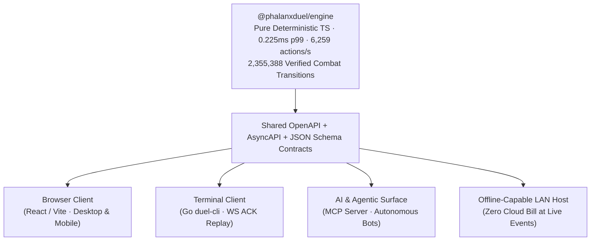
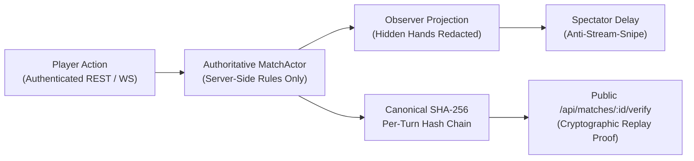
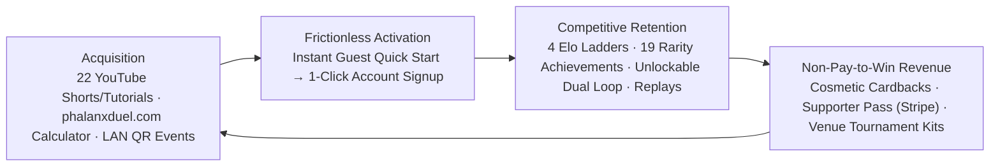
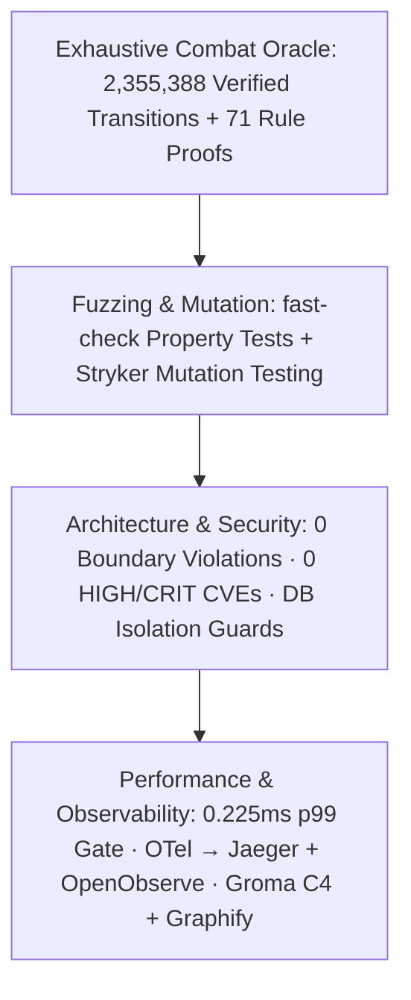
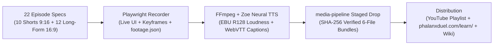

# Phalanx Duel — Player, Partner & Investor Diagrams

Eight high-signal visual maps complementing the engineering ERD, module DAG, and infrastructure topology in `docs/library/index.html`.

---

## Part 1 — For Visitors & Players

### 1. Column Cascade & Suit Boundary Map

### 2. Player Skill Ladder & Mode Journey

### 3. Player-Friendly 5-Step Turn Loop

---

## Part 2 — For Investors, Sponsors & Venue Partners

### 4. "One Deterministic Engine → Many Surfaces" Platform Moat

### 5. Provable Fair-Play & Esports Integrity Chain

### 6. Acquisition, Retention & Monetization Flywheel

### 7. Engineering Assurance Pyramid (Technical Due Diligence)

### 8. Automated Content & Marketing Engine

